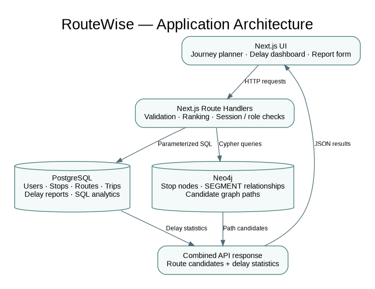

# RouteWise

**RouteWise: A Graph-Based Bengaluru BMTC Bus Route Planning and Delay Analytics System**

A two-member DBMS Level 3 project. RouteWise stores structured transit records (users, stops, routes, buses, trips, timings, delay reports, alerts, audit log) in **PostgreSQL** and the stop network in **Neo4j**. The Next.js app finds candidate journeys in Neo4j, then ranks them using recent delays from PostgreSQL. The stop names, schedules and delays are illustrative sample data inspired by Bengaluru; this is not a live BMTC service.

## Architecture

| Component | Responsibility |
|---|---|
| PostgreSQL | Source of truth: 11 tables with keys, constraints and indexes; a view, a function, a procedure, 3 triggers, 3 database roles |
| Neo4j | 15 `:Stop` nodes and 19 `:SEGMENT` relationships; variable-length path search and transfers |
| Next.js 14 (TypeScript) | Pages and 15 API route handlers; authentication and role checks; parameterised SQL and Cypher |
| Shared key | Neo4j `Stop.stopId` = PostgreSQL `stops.stop_id`; `SEGMENT.routeCode` = `routes.route_code` |



## Main capabilities

- **Journey planner** (`/`): Neo4j finds every path of up to 8 segments. Each is scored as segment minutes + 5 min per transfer + the average delay reported on each route in the last 3 hours (PostgreSQL), and the fastest is recommended.
- **Delay dashboard** (`/dashboard`): report count, average and maximum delay per route from the `route_delay_summary` view, refreshed every 5 s.
- **Report a delay** (`/report-delay`, staff/admin): INSERT inside a transaction that first checks that the stop belongs to the trip.
- **Manage** (`/admin`, staff/admin): UPDATE and DELETE delay reports (PostgreSQL); CREATE, UPDATE and DELETE route segments (Neo4j). Refreshes every 5 s, so one user's change appears for others.
- **Database** (`/admin/database`, admin): application accounts (delete staff/commuter accounts), PostgreSQL role privileges, delay alerts and the audit log, read live from the system catalog.
- **Database logic**: BEFORE trigger cleans the cause text and stamps edits; AFTER triggers raise alerts for 15+ minute delays and audit every change with the acting user; function `get_route_delay_stats`; procedure `resolve_route_alerts`.
- **Security**: bcrypt password hashes, signed HTTP-only session cookies, `requireRole()` on every protected endpoint, account re-checked on every request, PostgreSQL roles with GRANTs.

### Roles

| Action | COMMUTER | DEPOT_STAFF | ADMIN |
|---|---|---|---|
| Plan journeys, view dashboard | yes | yes | yes |
| Report and edit delays | – | yes | yes |
| Delete delay reports | – | – | yes |
| Add / edit / delete Neo4j segments | – | – | yes |
| Database page; delete staff/commuter accounts | – | – | yes |

## Prerequisites

| Software | Version |
|---|---|
| Node.js | 20.6 or newer |
| PostgreSQL | 15 or newer (includes `psql`) |
| Neo4j | 5.x (Neo4j Desktop or AuraDB) |
| Git | any |

## Setup

### 1. PostgreSQL

```bash
psql -U postgres -h localhost -c "CREATE DATABASE routewise;"
psql -U postgres -h localhost -d routewise -f database/01_schema.sql
psql -U postgres -h localhost -d routewise -f database/02_seed.sql
psql -U postgres -h localhost -d routewise -f database/03_routines.sql
psql -U postgres -h localhost -d routewise -f database/04_access.sql
psql -U postgres -h localhost -d routewise -f database/07_ddl_demo.sql
psql -U postgres -h localhost -d routewise -f database/08_verify.sql
```

See [database/README.md](database/README.md) for what each script does. `05_dml.sql` and `06_queries.sql` are demonstration scripts that roll back their changes.

### 2. Neo4j

Start a Neo4j 5 instance, open Neo4j Browser and run [neo4j/01_create_graph.cypher](neo4j/01_create_graph.cypher). Check with `MATCH (s:Stop) RETURN count(s)` (expect 15). See [neo4j/README.md](neo4j/README.md).

### 3. Environment

Copy `.env.example` to `.env.local` and fill in `DATABASE_URL`, `NEO4J_PASSWORD` and a random `SESSION_SECRET` of 32+ characters:

```bash
node -e "console.log(require('crypto').randomBytes(32).toString('hex'))"
```

Never commit `.env.local` (it is in `.gitignore`).

### 4. Install, run and create staff/admin accounts

```bash
npm install
npm run dev                                   # http://localhost:3000
node scripts/create-user.mjs admin@routewise.local "Project Admin" ADMIN
node scripts/create-user.mjs staff@routewise.local "Depot Staff" DEPOT_STAFF
```

`create-user.mjs` reads `DATABASE_URL` from the environment and asks for a password. Commuters register themselves on `/register`.

## Test

```bash
npm run test:db      # 12 automated database tests, all inside rolled-back transactions
npm run build        # type-check and production build
```

Manual end-to-end test cases and their results are in [docs/test-cases.md](docs/test-cases.md).

## Project structure

```
routewise/
├── app/                      Next.js App Router
│   ├── page.tsx              Journey planner
│   ├── dashboard/            Delay dashboard
│   ├── report-delay/         Delay report form
│   ├── admin/                Manage page; admin/database: Database page
│   ├── login/, register/     Authentication pages
│   ├── AuthLink.tsx          Sign in / Sign out / Database link
│   └── api/                  15 route handlers (stops, routes, analytics, report-options,
│                             delay-reports, auth/*, admin/*)
├── lib/                      db.ts (pool, withAppUser), neo4j.ts, auth.ts, journeys.ts
├── database/                 01_schema … 08_verify SQL scripts + README
├── neo4j/                    01_create_graph, 02_queries, 03_crud_demo + README
├── scripts/create-user.mjs   Create ADMIN / DEPOT_STAFF accounts
├── tests/db.test.mjs         Automated database tests
└── docs/                     ER diagram, relational schema, data dictionary,
                              architecture, requirements, test cases
```

## Documentation

- [ER diagram (Chen notation)](docs/er-diagram.png) and [relational schema](docs/relational-schema.png)
- [Data dictionary](docs/data-dictionary.md)
- [Requirements](docs/requirements.md)
- [Test cases and results](docs/test-cases.md)

## Limitations

- Sample data is illustrative, not live BMTC data.
- The planner uses segment minutes, a 5-minute transfer allowance and recent delays, not full timetables or waiting times.
- PostgreSQL and Neo4j are seeded separately; a new stop must be added to both.
- Live updates use 5-second polling rather than push notifications.
